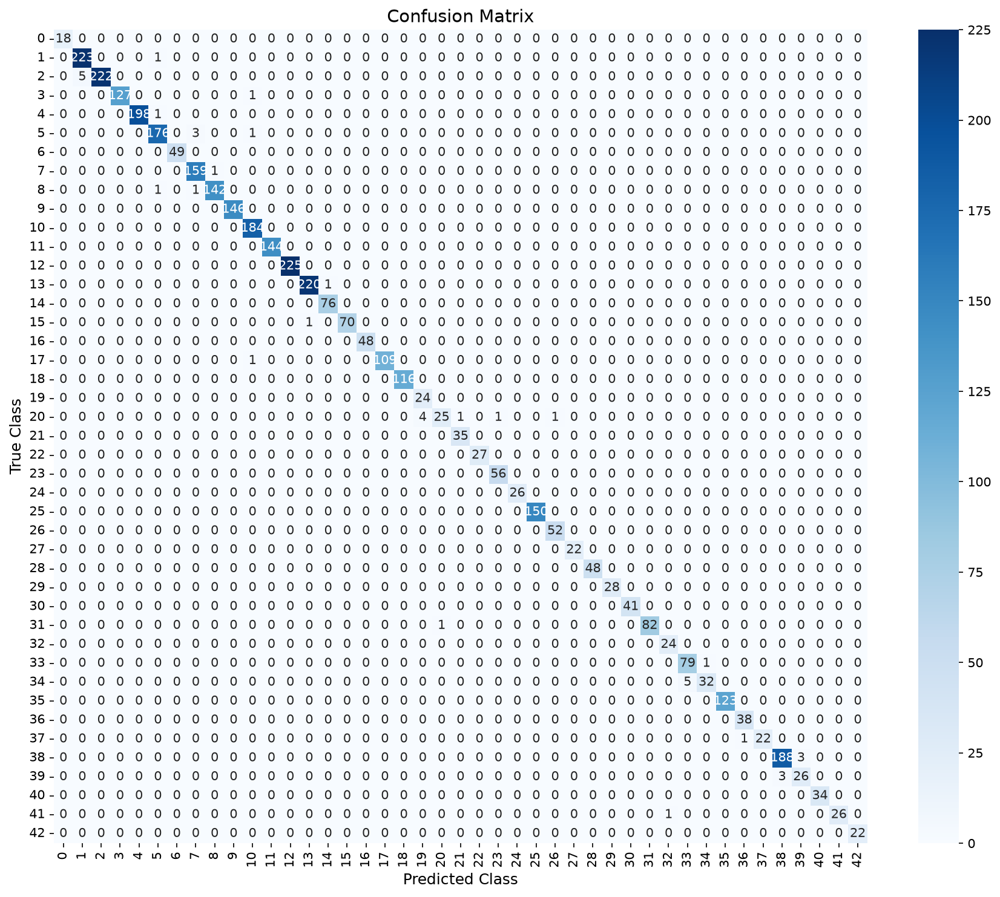
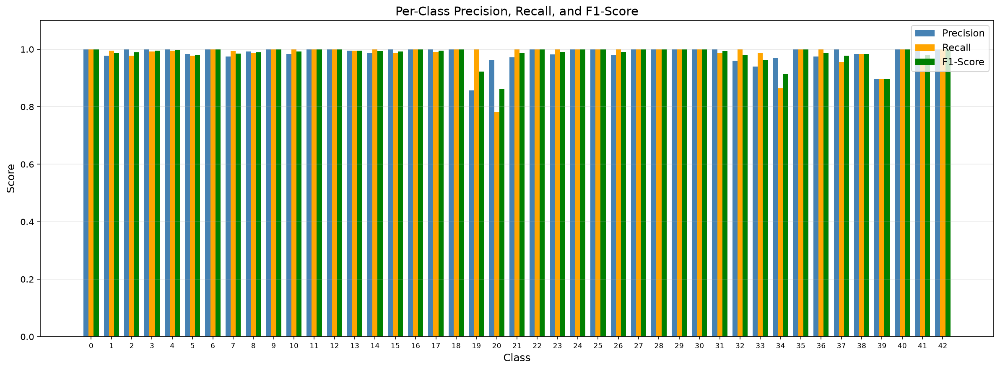
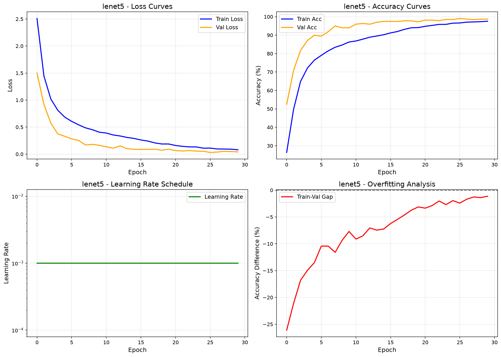

# Traffic Sign Recognition · GTSRB 德国交通标志识别

基于 PyTorch 的交通标志分类实验：在同一份数据、同一套预处理下实现 **LeNet-5** 与 **自定义 CNN** 两套卷积网络，完成 数据加载 → 增强 → 训练 → 测试评估 → 可视化 → 报告生成 的全流程。

## 结果（GTSRB 测试集）

| 模型 | 准确率 | 宏平均 Precision | 宏平均 Recall | 宏平均 F1 |
|---|---|---|---|---|
| **LeNet-5（增强版：BatchNorm + Dropout + 数据增强）** | **98.98%** | 0.9900 | 0.9898 | 0.9897 |
| 自定义 CNN | 83.20% | — | — | — |

> 指标由 `results/comparison.txt` 与段末评估脚本直接输出；模型权重、混淆矩阵、逐类指标图均在 `results/` 下。







## 数据集

GTSRB（German Traffic Sign Recognition Benchmark）：**43 类**交通标志，训练集约 3.9 万张、测试集约 1.3 万张。

数据集体积约 **477MB**，未纳入版本库（见 `.gitignore` 中的 `data/`）。请自行下载后放到 `data/gtsrb/`：

- 官方：https://benchmark.ini.rub.de/
- Kaggle 镜像：https://www.kaggle.com/datasets/meowmeowmeowmeowmeow/gtsrb-german-traffic-sign

## 快速开始

```bash
pip install -r requirements.txt
python main.py            # 依次训练两套模型、评估并出图
python generate_report.py # 可选：自动生成课程设计报告 docx
```

## 目录结构

```
main.py                 主流程：训练 + 评估 + 对比
generate_report.py      根据 results/ 自动生成报告文档
src/data_loader.py      数据加载、划分、增强
src/models.py           LeNet-5 / CustomCNN 网络定义
src/train.py            训练循环、早停、学习率调度
src/evaluate.py         准确率 / P / R / F1、混淆矩阵、逐类指标
src/utils.py            随机种子、设备、绘图等工具
results/                权重、混淆矩阵、训练曲线、逐类指标
```

## 说明

- 训练在 CPU 上也可完成，默认使用固定随机种子，结果可复现。
- 课程设计报告见 `230410434-孙玉杰.docx`（20+ 页，含网络参数表、实验对比与误差分析）。

## License

MIT
